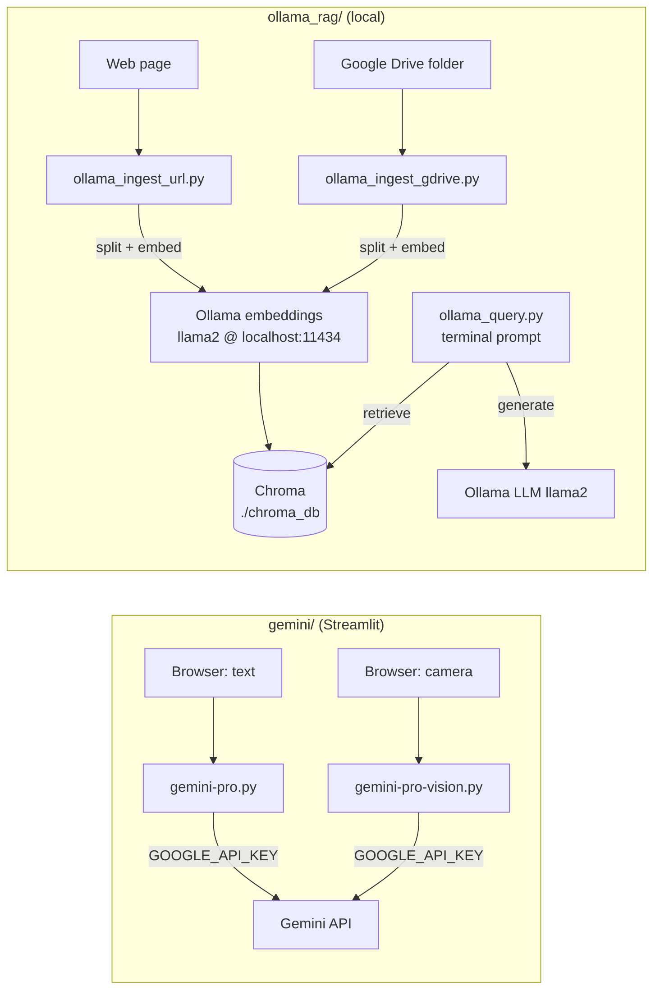

# Langchains

Small generative-AI experiments in Python: two Streamlit apps that call Google's Gemini API, and a
local retrieval-augmented generation (RAG) pipeline built with LangChain, Ollama and Chroma.

## Description

This repository collects short, self-contained scripts written while trying out LLM tooling in late
2023. It is useful as a starting point or reference for:

- calling the Gemini API from a Streamlit UI (text and image input);
- building a fully local RAG flow: load documents (web page or Google Drive folder), split them,
  embed them with an Ollama model, store them in Chroma, and ask questions from the terminal.

## Features

**`gemini/`: Streamlit apps on the Gemini API**

- `gemini-pro.py`: text box plus a button; sends the question to the `gemini-pro` model and shows
  the answer as a chat bubble.
- `gemini-pro-vision.py`: takes a photo with the browser camera and sends it to
  `gemini-pro-vision` with a fixed prompt (estimate the age of the person in the photo).

**`ollama_rag/`: local RAG with LangChain**

- `ollama_ingest_url.py`: loads one web page, splits it into 500-character chunks, embeds them and
  saves them to Chroma.
- `ollama_ingest_gdrive.py`: loads the documents of one Google Drive folder, splits them into
  4000-character chunks, embeds them and saves them to Chroma.
- `ollama_query.py`: interactive prompt that retrieves relevant chunks from Chroma and answers with
  a local Ollama LLM (`RetrievalQA`, "stuff" chain), streaming the answer to stdout.
- `chroma.py`: shared helper that writes documents to a persistent Chroma collection.

## Architecture



## Requirements

- Python 3.9 or newer (dependencies are pinned to late-2023 versions; a recent Python may need
  newer pins).
- For `gemini/`: a Gemini API key from [Google AI Studio](https://aistudio.google.com/).
- For `ollama_rag/`: [Ollama](https://ollama.com/) running locally on port 11434 with the `llama2`
  model pulled (`ollama pull llama2`).
- For the Google Drive loader: a Google Cloud OAuth client with the Drive API enabled (see
  [Configuration](#configuration)).

Each folder has its own `requirements.txt`, so use one virtual environment per folder.

## Quick start

### Gemini Streamlit apps

```bash
git clone https://github.com/Lapeyus/langchains.git
cd langchains/gemini

python3 -m venv .venv
source .venv/bin/activate
pip install -r requirements.txt

echo 'GOOGLE_API_KEY=<your-key>' > .env
streamlit run gemini-pro.py          # or: streamlit run gemini-pro-vision.py
```

Streamlit opens the app at <http://localhost:8501>.

### Local RAG with Ollama

```bash
cd langchains/ollama_rag

python3 -m venv .venv
source .venv/bin/activate
pip install -r requirements.txt

ollama pull llama2
python ollama_ingest_url.py          # builds ./chroma_db from the sample web page
python ollama_query.py               # ask questions at the "> " prompt
```

## Usage

**Ingest a different web page.** Edit the URL passed to `WebBaseLoader` in
`ollama_ingest_url.py`, then run it again. New chunks are added to the same collection.

**Ingest a Google Drive folder.**

```bash
echo 'FOLDER_ID=<drive-folder-id>' >> .env
python ollama_ingest_gdrive.py
```

**Query.** Run `ollama_query.py` from the same directory you ingested from (Chroma is stored in
`./chroma_db` relative to the working directory):

```text
> What are the main components of an LLM-powered agent?
```

Stop with Ctrl+C.

**Change models.** The Ollama model (`llama2`) and URL (`http://localhost:11434`) are hard-coded in
each `ollama_*.py` script; the Gemini model names are hard-coded in each Streamlit app.

## Repository structure

```text
.
├── gemini/
│   ├── gemini-pro.py           # Streamlit text Q&A on Gemini
│   ├── gemini-pro-vision.py    # Streamlit camera snapshot -> Gemini vision
│   ├── requirements.txt
│   └── README.md               # generic Google Cloud Code sample README (see limitations)
├── ollama_rag/
│   ├── chroma.py               # save documents to a persistent Chroma collection
│   ├── ollama_ingest_url.py    # web page -> chunks -> embeddings -> Chroma
│   ├── ollama_ingest_gdrive.py # Drive folder -> chunks -> embeddings -> Chroma
│   ├── ollama_query.py         # interactive RetrievalQA over Chroma with Ollama
│   └── requirements.txt
├── LICENSE                     # MIT
└── README.md
```

## Configuration

Settings are read from a `.env` file in the folder you run from (loaded with `python-dotenv`):

| Variable | Used by | Purpose |
|---|---|---|
| `GOOGLE_API_KEY` | `gemini/*.py` | Gemini API key |
| `FOLDER_ID` | `ollama_rag/ollama_ingest_gdrive.py` | ID of the Google Drive folder to ingest |

The Drive loader (LangChain `GoogleDriveLoader`) also needs an OAuth client file. By default it
looks for `~/.credentials/credentials.json` and caches the user token next to it in
`~/.credentials/token.json`.

Keep out of Git: `.env` (already in `.gitignore`), OAuth `credentials.json`/`token.json`, and the
generated `chroma_db/` folder (not in `.gitignore`).

## Tests

There are no automated tests.

## Project status

**Archived experiment.** All commits are from 18 December 2023 and the code has not been updated
since.

### Known limitations

- The `gemini-pro` and `gemini-pro-vision` model names and the `google-generativeai` 0.3.x SDK are
  from the first Gemini release; Google has since retired those models, so the apps need a current
  model name (and likely a newer SDK) to work.
- The RAG scripts use LangChain 0.0.350 import paths (`langchain.vectorstores`,
  `langchain.llms`, ...), which moved to `langchain_community` in later releases.
- `ollama_ingest_gdrive.py` builds a list of documents with extra metadata (`source`, `rag`) but
  then splits the original documents, so that metadata is never stored.
- `ollama_ingest_url.py` has its source URL hard-coded.
- Running an ingest script twice adds duplicate chunks; there is no de-duplication.
- `gemini/README.md` is the stock Google Cloud Code sample README: it mentions `main.py` and
  `launch.json`, which are not in this repo.
- `langchain-google-genai` is listed in `gemini/requirements.txt` but not used.

## Contributing

Fork the repository and open a pull request.

## Acknowledgments

- [Streamlit](https://streamlit.io/)
- [Google AI / Gemini API](https://ai.google.dev/)
- [LangChain](https://github.com/langchain-ai/langchain)
- [Ollama](https://ollama.com/)
- [Chroma](https://www.trychroma.com/)

## License

MIT. See [LICENSE](LICENSE).
